# Flux Protocol 核心流程技术文档

> 本文档基于当前 `src/` 合约实现，描述核心调用链、生命周期与模块关系。  
> 协议基线：`1 Asset Unit = 1 NFT = 10,000 FLUX`，总量固定 10,000 Asset Units。

---

## 目录

1. [资产模型与状态机](#1-资产模型与状态机)
2. [模块架构与依赖关系](#2-模块架构与依赖关系)
3. [角色与权限矩阵](#3-角色与权限矩阵)
4. [Genesis 拍卖流程](#4-genesis-拍卖流程)
5. [Credit 具现化流程](#5-credit-具现化流程)
6. [NFT ↔ FT 转换流程](#6-nft--ft-转换流程)
7. [动态 Fee / Reward 流程](#7-动态-fee--reward-流程)
8. [FeeEngine 分配流程](#8-feeengine-分配流程)
9. [Genesis 奖励与 FluxAccount 生命周期](#9-genesis-奖励与-fluxaccount-生命周期)
10. [流动性 Vault 与 LP 复投](#10-流动性-vault-与-lp-复投)
11. [Trait 生成流程](#11-trait-生成流程)
12. [关键不变量](#12-关键不变量)

---

## 1. 资产模型与状态机

### 1.1 总量分配

| 区间 | Asset ID | 初始状态 | 数量 |
|------|----------|----------|------|
| Credit 区 | 1 ~ 5,000 | `Credit` | 5,000（拍卖发行） |
| FT 区 | 5,001 ~ 10,000 | `FT`（惰性） | 5,000（LP bootstrap 用 FLUX） |

### 1.2 AssetRegistry 状态

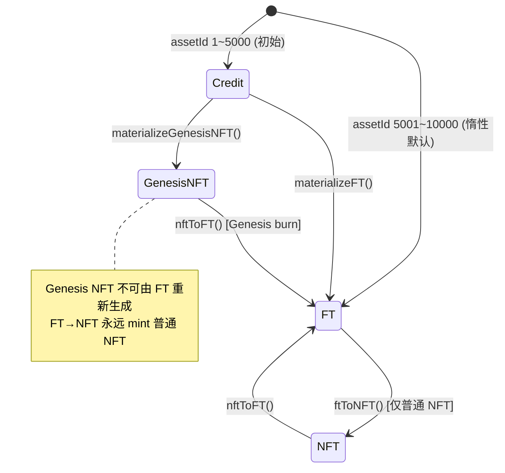

**惰性存储**：未发生转换的 Asset 不写入 storage，通过 `assetId <= initialCreditUnits` 推导默认状态；一旦发生 `transition()`，写入 `_overridden[assetId] = true`。

**唯一状态变更入口**：`AssetRegistry.transition()`，仅 `ConversionEngine`（`CONTROLLER_ROLE`）可调用。

---

## 2. 模块架构与依赖关系

### 2.1 分层架构图

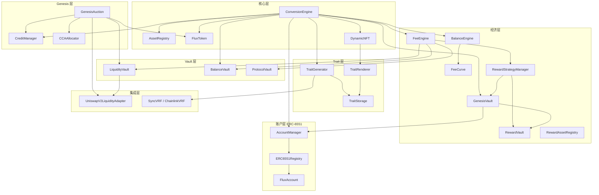

### 2.2 ConversionEngine 调用关系（核心枢纽）

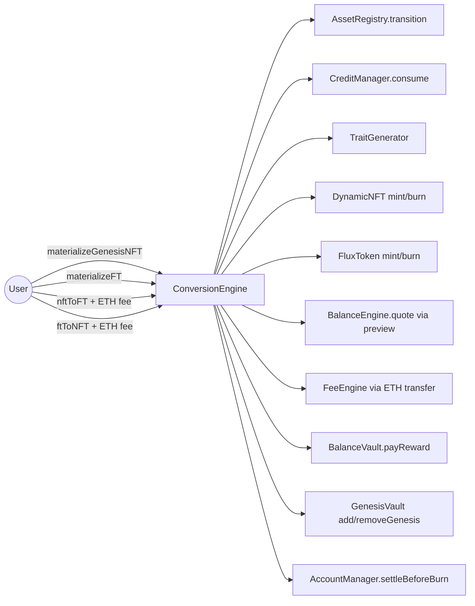

---

## 3. 角色与权限矩阵

部署脚本 `script/Deploy.s.sol` 中的关键授权：

| 合约 | 角色 | 持有者 | 用途 |
|------|------|--------|------|
| `AssetRegistry` | `CONTROLLER_ROLE` | `ConversionEngine` | 状态转换 |
| `CreditManager` | `ISSUER_ROLE` | `GenesisAuction` | 拍卖 claim 发 Credit |
| `CreditManager` | `CONSUMER_ROLE` | `ConversionEngine` | 具现化时销毁 Credit |
| `FluxToken` | `MINTER_ROLE` | `ConversionEngine`, `GenesisAuction` | Mint FLUX |
| `FluxToken` | `BURNER_ROLE` | `ConversionEngine` | Burn FLUX |
| `DynamicNFT` | `MINTER/BURNER_ROLE` | `ConversionEngine` | Mint/Burn NFT |
| `TraitGenerator` | `CALLER_ROLE` | `ConversionEngine` | 触发随机与生成 |
| `GenesisVault` | `CONTROLLER_ROLE` | `ConversionEngine` | add/remove Genesis |
| `GenesisVault` | `DEPOSITOR_ROLE` | `RewardStrategyManager` | 入账奖励 |
| `RewardVault` | `ACCOUNTANT_ROLE` | `GenesisVault` | 增减 liability / pay |
| `RewardStrategyManager` | `EXECUTOR_ROLE` | `FeeEngine` | holdNative / execute |
| `BalanceVault` | `REWARDER_ROLE` | `ConversionEngine` | 再平衡奖励 |
| `AccountManager` | `SETTLEMENT_ROLE` | `ConversionEngine` | Burn 前 sweep TBA |
| `LiquidityVault` | `GENESIS_REGISTRAR_ROLE` | `GenesisAuction` | 注册核心 LP |
| `LiquidityVault` | `LP_MANAGER_ROLE` | 需治理另行授予 | LP 复投 compound |

---

## 4. Genesis 拍卖流程

### 4.1 拍卖状态机

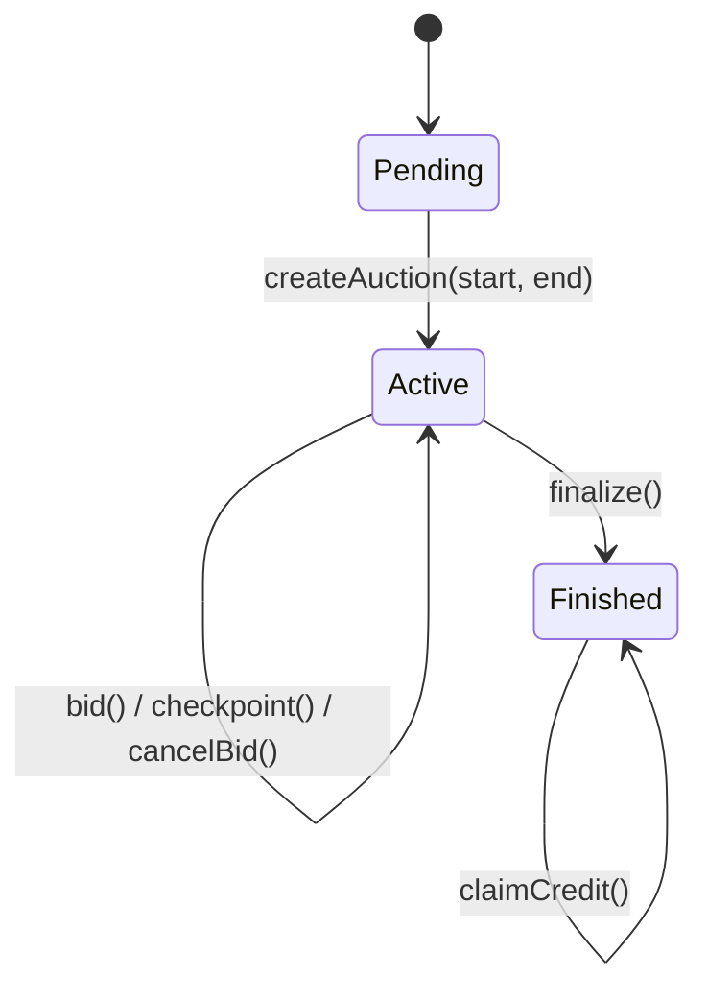

### 4.2 时序图：Continuous MPS CCA（Scheme C）

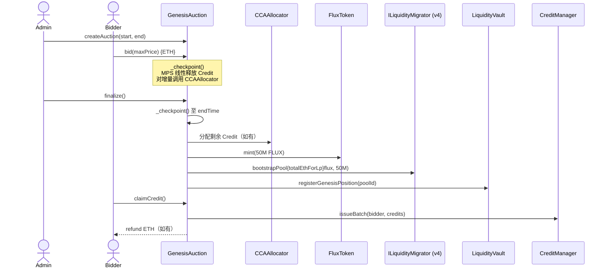

**MPS 释放**：`creditsReleased += 5000 × (Δt / duration)`（WAD 精度），每 checkpoint 将 `floor(released) - allocated` 的整数 Credit 通过 `CCAAllocator` 分配给有效 bid。

**LP**：Genesis 使用 `ILiquidityMigrator`（v4）；Runtime 复投仍用 `ILiquidityAdapter`（V2 compound）。

### 4.3 CCA 清算要点

- **Clearing Price**：所有 bid 的 `maxPrice` 去重排序，找到满足总需求 ≥ 5,000 Credit 的最低清算价。
- **分配**：`maxPrice >= clearingPrice` 的 bid 按 `budget / clearingPrice` 计算原始 credits；若总量超额，**pro-rata** 缩减。
- **LP Bootstrap**：各 bid 的 `cost = credits × clearingPrice` 汇总为 `totalEthForLp`，与 50M FLUX 一起初始化 Uniswap V2 LP，LP 代币锁入 `lpLock`。

---

## 5. Credit 具现化流程

### 5.1 Credit → Genesis NFT

**调用方**：Credit 持有者  
**入口**：`ConversionEngine.materializeGenesisNFT(assetId, seed)`

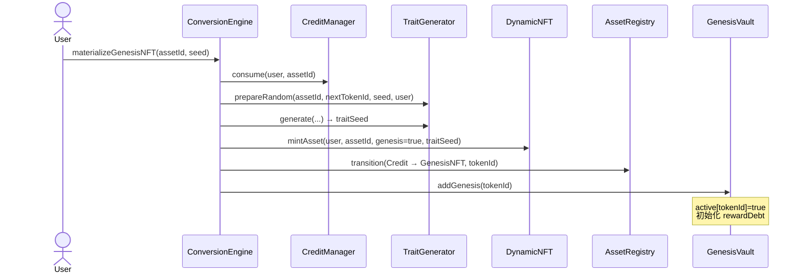

**注意**：此流程 **不创建** FluxAccount；TBA 在首次 `claim` 时懒创建。

### 5.2 Credit → FT

**入口**：`ConversionEngine.materializeFT(assetId)`

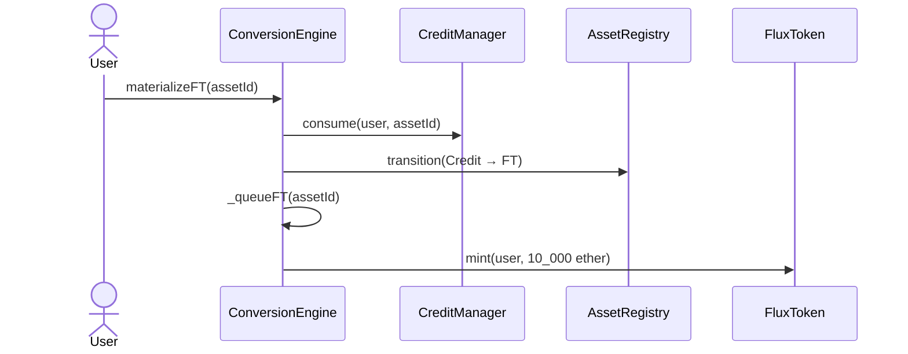

---

## 6. NFT ↔ FT 转换流程

### 6.1 NFT → FT

**入口**：`ConversionEngine.nftToFT(tokenId)` + `msg.value = preview(false).fee`

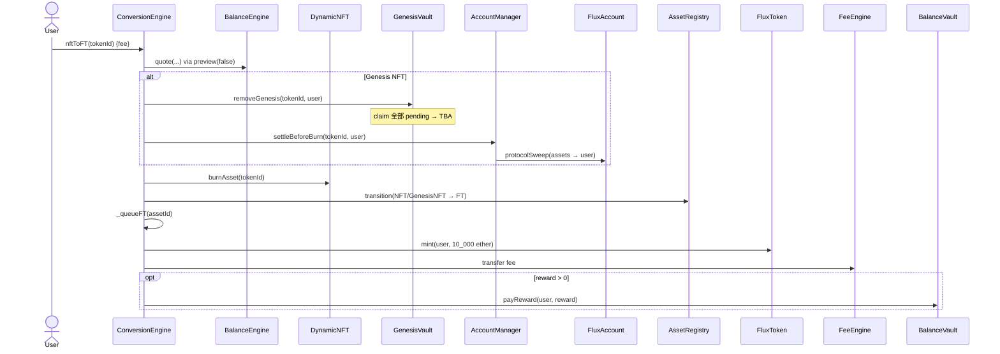

| 类型 | Genesis 权益 | TBA 处理 | FT 队列 |
|------|-------------|----------|---------|
| Genesis NFT | 永久销毁 | sweep 到用户 | assetId 入队 |
| 普通 NFT | 无 | 协议不处理 | assetId 入队 |

### 6.2 FT → NFT

**入口**：`ConversionEngine.ftToNFT(seed)` + `msg.value = preview(true).fee`  
**约束**：永远 mint **普通 NFT**（`genesis=false`），不可恢复 Genesis 权益。

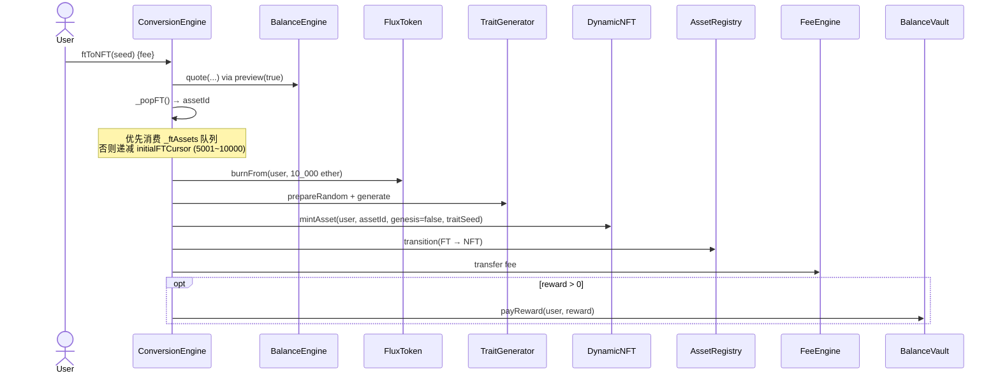

### 6.3 FT 资产 ID 来源

```text
_popFT() 优先级：
1. _ftAssets 栈顶（由 materializeFT / nftToFT 入队）
2. initialFTCursor 递减（5001 → 10000 惰性区间）
```

---

## 7. 动态 Fee / Reward 流程

### 7.1 目标区间

- **FT 占比目标**：30% ~ 40%（`BalanceEngine.lowerBps=3000`, `upperBps=4000`）
- **中性区**：fee ≈ 0，reward = 0

### 7.2 FeeCurve 逻辑

```mermaid
flowchart TD
    Start[preview(ftToNft)] --> Ratio[计算 ftRatioBps = FT / (FT+NFT)]
    Ratio --> BE[BalanceEngine.quote]
    BE --> FC[FeeCurve]

    FC -->|FT > 40%, FT→NFT| R1[reward > 0]
    FC -->|FT > 40%, NFT→FT| F1[fee > 0]
    FC -->|FT < 30%, NFT→FT| R2[reward > 0]
    FC -->|FT < 30%, FT→NFT| F2[fee > 0]
    FC -->|30%~40%| Zero[fee=0, reward=0]

    R1 & R2 --> Budget[budget = availableReward × rewardQuoteBps / 10000]
    F1 & F2 --> MaxFee[fee ≤ maxFee (0.01 ETH)]
```

### 7.3 预算双层控制

| 层级 | 合约 | 机制 |
|------|------|------|
| 日预算 | `BalanceVault` | `epochBudget = balance × dailyReleaseBps / 10000`（默认 0.1%/天） |
| 单笔上限 | `BalanceEngine` | `budget = availableReward × rewardQuoteBps / 10000`（默认 1%） |
| 硬检查 | `BalanceVault.payReward` | `epochSpent + amount ≤ epochBudget`，否则 revert |

**Reward 路径**：`ConversionEngine` → `BalanceVault.payReward(user)` → **直接到用户 EOA**（不经 TBA）。

**Fee 路径**：`ConversionEngine` → `FeeEngine.receive()` → 后续 `distribute()`。

---

## 8. FeeEngine 分配流程

### 8.1 默认分成（10000 bps）

| 去向 | bps | 默认比例 |
|------|-----|----------|
| `LiquidityVault` | 3,000 | 30% |
| `RewardStrategyManager` → Genesis | 2,500 | 25% |
| `BalanceVault` | 2,500 | 25% |
| `ProtocolVault` | 2,000 | 20% |

### 8.2 时序图

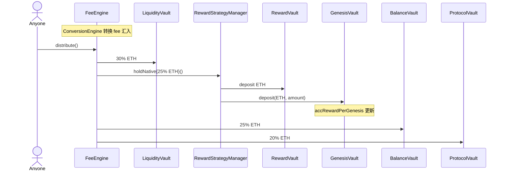

### 8.3 RewardStrategy 扩展路径

除 `holdNative()`（直接存 ETH）外，治理可注册 Strategy Adapter：

```text
FeeEngine (EXECUTOR) → RewardStrategyManager.execute(id, ...)
    → IRewardStrategy.execute() [swap / hold 等]
    → _depositReward(outputAsset, amountOut)
        → RewardVault（托管）
        → GenesisVault.deposit()（记账）
```

---

## 9. Genesis 奖励与 FluxAccount 生命周期

### 9.1 奖励双层结构

| 合约 | 职责 |
|------|------|
| `RewardVault` | **托管** ETH/ERC20；维护 `liability[asset]`（总欠债） |
| `GenesisVault` | **分账**：`accRewardPerGenesis` + `rewardDebt[tokenId]`（MasterChef 模式） |

### 9.2 Claim 时序

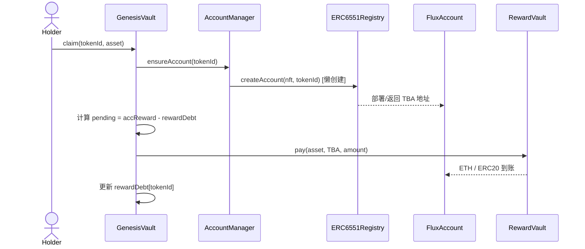

### 9.3 FluxAccount 生命周期

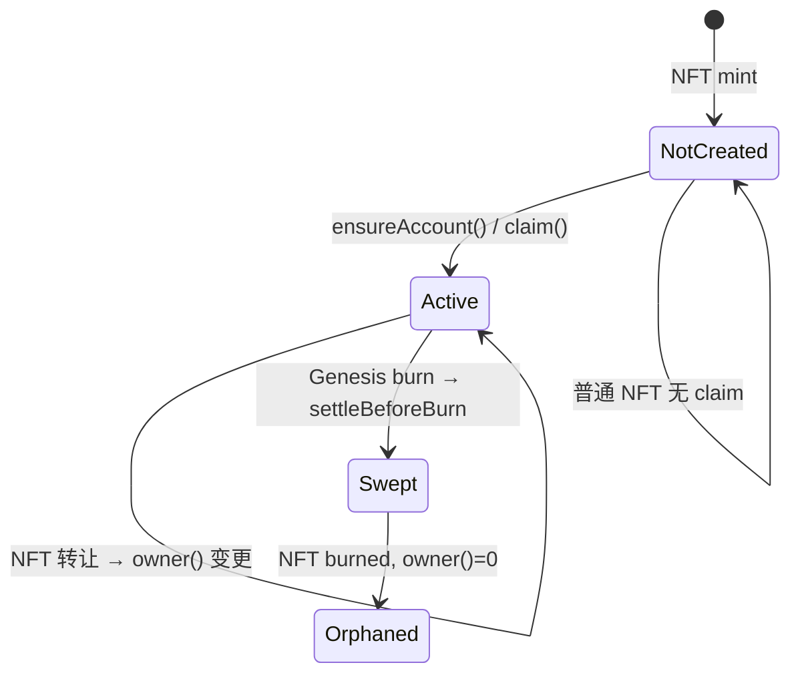

| 事件 | TBA 行为 |
|------|----------|
| Genesis NFT mint | 不创建 TBA |
| 首次 claim | 懒创建 TBA，奖励入账 |
| NFT 转让 | TBA 地址不变；`owner()` 随 `nft.ownerOf` 变化 |
| 用户提现 | NFT owner 调 `FluxAccount.execute(target, value, data)` |
| Genesis NFT → FT | `removeGenesis` claim pending → `protocolSweep` 扫给用户 → burn |
| 普通 NFT → FT | 协议不处理 TBA |
| FT → NFT | 新 tokenId，不创建 TBA，无 Genesis 权益 |

### 9.4 TBA 地址确定性

```solidity
// ERC6551Registry._fluxSalt
keccak256(abi.encode(chainId, nft, tokenId))
```

同一 `(nft, tokenId)` 永远映射到同一 `FluxAccount` 地址；合约部署后不可变。

---

## 10. 流动性 Vault 与 LP 复投

### 10.1 Genesis LP 锁定

```text
GenesisAuction.finalize()
  → UniswapV2LiquidityAdapter.initializePool()
  → LP tokens → lpLock（永久锁定）
  → LiquidityVault.registerGenesisPosition(pair)
```

`genesisPosition` **永久锁定**，`LiquidityVault.compound()` 禁止 `target == genesisPosition`。

### 10.2 LP 复投流程

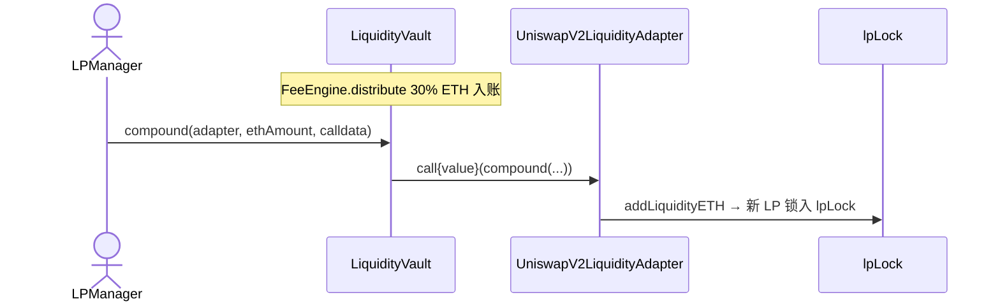

---

## 11. Trait 生成流程

### 11.1 触发时机

- `materializeGenesisNFT(assetId, seed)`
- `ftToNFT(seed)`

### 11.2 时序图

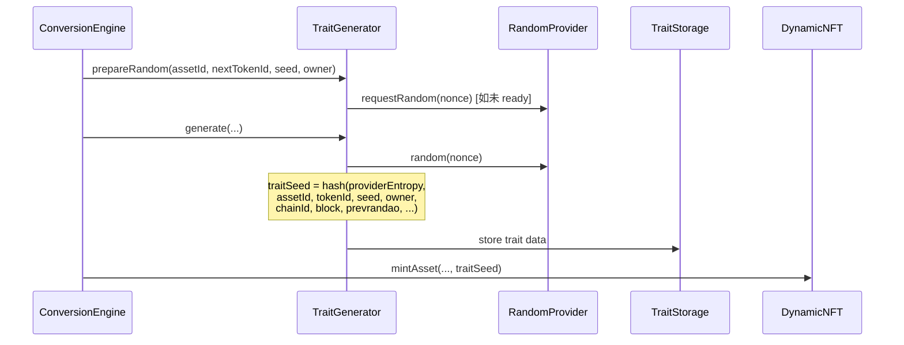

### 11.3 释放与重新生成

- **NFT → FT**：`traitGenerator.release(assetId)` 释放 trait 槽位
- **FT → NFT**：同一 `assetId` 重新 mint 时按新 `tokenId`、新区块变量 **重新 roll trait**

---

## 12. 关键不变量

| 不变量 | 说明 |
|--------|------|
| Asset 总量 | `accountedUnits()` 恒为 10,000 |
| FLUX 供应 | `flux.totalSupply / UNIT == FT units` |
| Genesis 不可再生 | `ftToNFT` 永远 `genesis=false`；Genesis 权益仅在 Credit→GenesisNFT 路径产生 |
| RewardVault 偿付能力 | `balance(asset) >= liability(asset)` |
| Epoch 预算 | `BalanceVault.payReward` 满足 `epochSpent + amount ≤ epochBudget` |
| 核心 LP 不可动 | `LiquidityVault.compound` 禁止操作 `genesisPosition` |
| 状态一致性 | 所有 Asset 状态变更必须经过 `ConversionEngine` → `AssetRegistry.transition` |

---

## 附录 A：用户操作速查

| 用户意图 | 入口合约 | 函数 |
|----------|----------|------|
| 拍卖出价 | `GenesisAuction` | `bid(maxPrice)` |
| 领取 Credit | `GenesisAuction` | `claimCredit()` |
| Credit → Genesis NFT | `ConversionEngine` | `materializeGenesisNFT(assetId, seed)` |
| Credit → FT | `ConversionEngine` | `materializeFT(assetId)` |
| NFT → FT | `ConversionEngine` | `nftToFT(tokenId)` + fee |
| FT → NFT | `ConversionEngine` | `ftToNFT(seed)` + fee |
| 预览 fee/reward | `ConversionEngine` | `preview(ftToNft)` |
| 领取 Genesis 奖励 | `GenesisVault` | `claim(tokenId, asset)` / `claimAllRegistered(tokenId)` |
| TBA 提现 | `FluxAccount` | `execute(target, value, data)` |
| 分配协议 fee | `FeeEngine` | `distribute()` |
| LP 复投 | `LiquidityVault` | `compound(target, amount, data)` |

## 附录 B：相关文档

- [Readme.md](../Readme.md) — 项目概览与脚本用法
- [docs/whitepaper.md](../docs/whitepaper.md) — 产品白皮书
- [docs/architecture-specification.md](../docs/architecture-specification.md) — 架构规范
- [docs/technical-specification.md](../docs/technical-specification.md) — 接口技术规范

---

*文档版本：与当前 `src/` 合约实现同步。生产部署前请以链上代码为准。*
